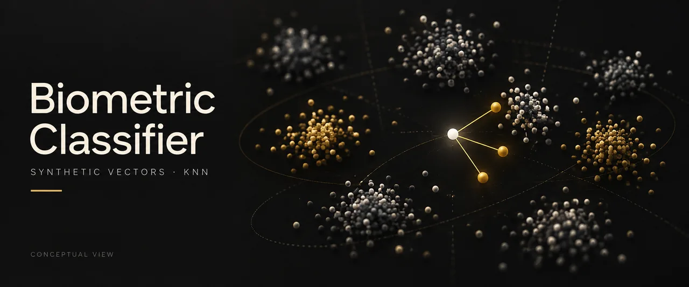

# Biometric Classifier



*Conceptual illustration, not program output.*

An educational experiment in classifying synthetic user vectors with K-nearest neighbors.

## Problem and objective

Explore a supervised classification workflow: generate labeled numerical samples, train a classifier, and evaluate predictions on a held-out subset.

## Scope and limitations

All vectors are synthetic. This is not face recognition, fingerprint recognition, or production authentication. High scores on separated random clusters do not establish biometric accuracy, robustness, or fairness. No real biometric dataset, persisted model, or API is included.

## How it works

`model.py` generates 10 random user centers, 20 noisy samples per center, and 64 features per sample. A seeded, stratified 70/30 split trains a 3-neighbor classifier. The reported metric is **accuracy**, not precision. The seed makes the demonstration repeatable.

## Technologies

Python, NumPy, scikit-learn (KNN, data splitting, accuracy).

## Installation and configuration

Use Python 3.11. From the repository root:

```powershell
python -m venv .venv
.venv/Scripts/python -m pip install -r requirements-lock.txt
```

`requirements-lock.txt` records the reviewed environment; `requirements.txt` lists direct dependencies.

On macOS/Linux, replace `.venv/Scripts/python` with `.venv/bin/python`.

## Run and example output

```powershell
.venv/Scripts/python main.py
```

```text
Synthetic test accuracy: 100.00%
```

This is an observed result for the bundled synthetic generator and seed, not a real-world performance claim.

## Data source

Generated in memory by `generate_dataset`; no download or real identities.

## Verification

```powershell
.venv/Scripts/python -m unittest discover -s tests -v
```

Verified with Python 3.11.9: two unit tests and the synthetic demo passed. Tests check reproducible data and classification on the generated users.

## Possible next steps

Future work could compare classifiers and test overlapping synthetic clusters. Real biometric evaluation would require a separate dataset, protocol, and privacy design.
